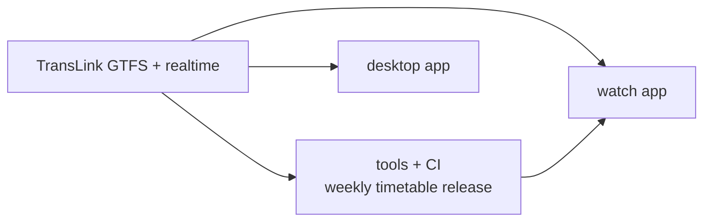

# NextTrain (Brisbane)

Next trains to **Home / Work** on the South-East Queensland (TransLink) network, with live delays. Free, no server,
no API key.

| | App | Folder |
|---|---|---|
| 🖥️ | macOS menu-bar / Windows tray app with reminders and arrival alerts (Python) | [`desktop/`](desktop) |
| ⌚ | Apple Watch app + complication, works offline from the timetable, live delays when online (Swift) | [`watch/`](watch) |
| 🔧 | Timetable build/publish tools used by CI and the watch app (Python) | [`tools/`](tools) |



## Documentation

| Read | When |
|---|---|
| [docs/architecture.md](docs/architecture.md) | **start here** – system overview, data model, Python ⇄ Swift mapping |
| [docs/development.md](docs/development.md) | setting up a machine, conventions, tests, personal config |
| [docs/desktop-app.md](docs/desktop-app.md) | macOS/Windows app design, config, build, gotchas |
| [docs/watch-app.md](docs/watch-app.md) | watchOS app and complication, Apple-platform primer, deploy to a watch |
| [docs/pipeline-and-ci.md](docs/pipeline-and-ci.md) | data sources, timetable pipeline, GitHub Actions, releases |
| [docs/PROJECT_CONTEXT.md](docs/PROJECT_CONTEXT.md) | original requirements and decision history |

## Quick start

```bash
make help            # list all tasks
make venv            # Python environment
make desktop-run     # run the desktop app from source
make watch-data watch-project && open watch/NextTrain.xcodeproj   # watch app (Xcode + XcodeGen needed)
```

## Install a packaged desktop build
- **macOS**: open `NextTrain.dmg`, drag *Next Train* to Applications. It's not notarised, so the first time
  right-click the app → **Open** (or `xattr -dr com.apple.quarantine "/Applications/Next Train.app"`).
  Apple-silicon builds only run on Apple-silicon Macs.
- **Windows**: unzip `NextTrain-windows.zip` and run `NextTrain.exe` (tray icon, bottom-right). SmartScreen may warn: *More info → Run anyway*.

Build the installers yourself with `make desktop-mac`, or run the **Build installers** GitHub Action to get the
.dmg and the Windows zip as artifacts. User data lives in `~/Library/Application Support/NextTrain` (macOS) or
`%APPDATA%\NextTrain` (Windows); use *Edit config…* in the menu.

## Using the desktop app
- macOS: scroll the train list with the mouse wheel, click a train to select it (green). Windows: each leg is a
  submenu with Earlier/Later paging; click a train to select it (✓).
- Select a train to work and a train home: reminders 15–10 min before departure and an alert near arrival. The later
  leg is assumed to start where the first one ends.
- 📍 sets where you are (home / work). Auto uses GPS on macOS if permitted (packaged app prompts), otherwise
  `fallback_location`. Windows has no GPS support.
- `desktop/config.json` (git-ignored, created from `desktop/config.example.json` on first run): stations (partial
  names OK), alert times, days (0=Mon), commute windows, fallback location.
- When no direct train is upcoming (e.g. weekend trackwork with a railbus), journeys with **one change** are shown.

## Licence and data
MIT licence (see `LICENSE`). Timetable and realtime data are from Translink (South-East Queensland), published as open
data; please check and follow their licence/attribution terms.
