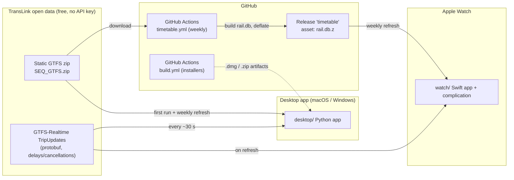
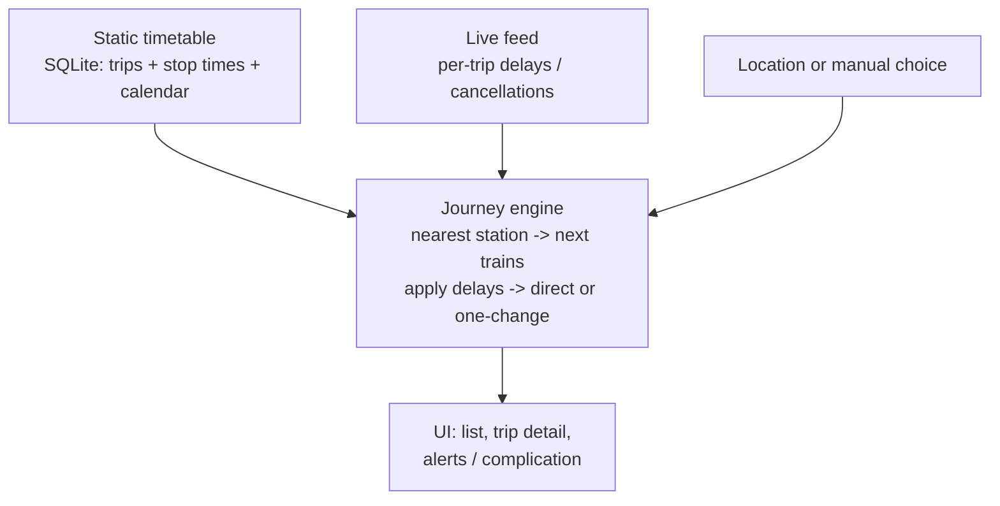

# Architecture overview

NextTrain answers one question: **"when is my next train, and is it late?"** for the South-East Queensland (TransLink)
rail network. It ships as three front-ends that share one idea (a timetable database plus a live-delay overlay):

| App | Folder | Language / UI | Runs on |
|---|---|---|---|
| Desktop menu-bar / tray app | [`desktop/`](../desktop) | Python (rumps on macOS, pystray on Windows) | macOS, Windows |
| Apple Watch app + complication | [`watch/`](../watch) | Swift / SwiftUI / WidgetKit | watchOS 10+ |
| Timetable build & publish tools | [`tools/`](../tools) | Python | CI (Linux) and developer machines |

There is **no server**. Everything runs on the user's device; the only network calls are to TransLink's public
feeds and to GitHub Releases (watch app timetable download).

## System context

## The core idea (shared by all apps)

1. **Offline first.** The timetable (SQLite, schema below) is always available, so scheduled times are shown with no network.
2. **Live overlay.** If the realtime feed is reachable, per-stop delays are added to scheduled times; cancelled trips are removed.
3. **Direction logic.** The app is configured with a *home* and a *work* station. Whichever is further from you is the
   direction you're about to travel; the return leg is assumed to start where the first leg ends.
4. **Journeys.** Direct trains if any are upcoming; otherwise journeys with **one change** (this handles weekend
   trackwork where a railbus runs to an interchange station and a train continues from there).

## The Python ⇄ Swift port

The watch app is a **port of the Python core**, not a wrapper. Both implementations must give the same answers.

| Concept | Python (`desktop/`) | Swift (`watch/NextTrainCore/`) |
|---|---|---|
| Timetable queries (direct trains, trip stops, nearest station) | `core.py` | `Timetable.swift`, `Engine.swift` |
| Realtime protobuf parse + delay rules (`_delay`) | `core.py` (`gtfs_realtime_bindings`) | `Realtime.swift` (hand-written reader, no dependency) |
| One-change journeys | `core.transfer_journeys` / `core.journeys` | `Timetable.transferJourneys` / `journeys` in `Engine.swift` |
| Snapshot (both directions) | `core.snapshot` | `Snapshot.swift` |
| Timetable builder (GTFS → SQLite) | `build_data.py` | not ported (CI/desktop only); the watch only *slims* the published DB (`TimetableSlimmer.swift`) |
| Alerts, selection state, menus | `engine.py`, `menubar.py`, `tray_win.py` | not applicable (watch is read-only) |

> **When you change journey/delay logic, change both** and compare outputs (see
> [development.md](development.md#keeping-python-and-swift-in-sync)).

## Timetable database schema

`rail.db` (built by `desktop/build_data.py`) and the slim `watch.db` share the same schema, so the Swift code reads either.

| Table | Columns | Notes |
|---|---|---|
| `stations` | id, name, lat, lon | one row per parent station |
| `trips` | trip_id, service_id, headsign, route | rail only (GTFS route_type 2) |
| `st` | trip_id, seq, station, stop_id, platform, dep | `dep` = seconds after service-day midnight; can exceed 86400 |
| `calendar` | service_id, dow, start, end | weekly pattern and validity range |
| `calendar_dates` | service_id, date, type | exceptions (type 1 = added, 2 = removed) |

Time zone is fixed `Australia/Brisbane` (no daylight saving). Because times can pass 24:00, queries look at
**yesterday, today and tomorrow** service days, each with its own midnight.

## Privacy model

The repository is public. Personal data stays out of git: your stations live in git-ignored `desktop/config.json` and
`watch/Shared/LocalConfig.swift`. The watch downloads the **full** timetable and filters it on-device, so the
stations you travel between never leave the device.

## Further reading
- [Desktop app](desktop-app.md) · [Watch app](watch-app.md) · [Data pipeline & CI](pipeline-and-ci.md)
- [Developer setup & conventions](development.md) · [History & decisions](PROJECT_CONTEXT.md)
