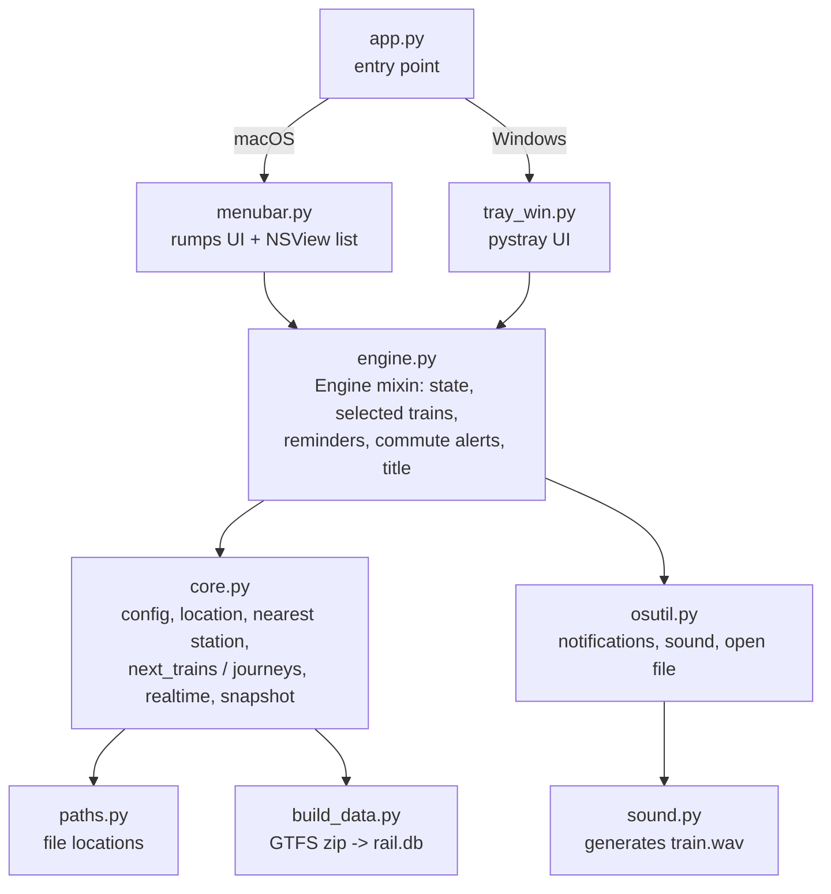
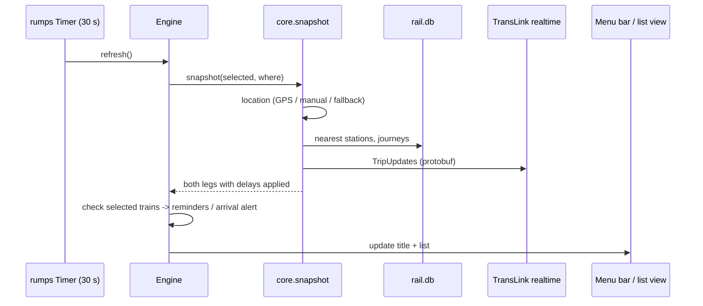

# Desktop app (macOS menu bar / Windows tray)

Folder: [`desktop/`](../desktop). Python 3.12+. Shows the next trains to Home/Work with live delays, lets you
select a train, and notifies you before departure and near arrival.

## Module map



| File | Role |
|---|---|
| `app.py` | Entry point. Picks `menubar.App` (macOS) or `tray_win.TrayApp` (Windows). |
| `core.py` | **Platform-independent logic.** Config, GPS/location, nearest stations, `next_trains`, `transfer_journeys`, `journeys`, `trip_stops`, realtime fetch and `_delay`, `live_arrival`, `snapshot`, `ensure_data`. |
| `engine.py` | **Platform-independent behaviour.** Persistent state, selected trains, reminder/arrival alerts, commute alerts, default scroll window, title text. |
| `menubar.py` | macOS UI only (rumps + PyObjC). `TrainListView` is an `NSView` embedded in a menu item (mouse-wheel scrolling). |
| `tray_win.py` | Windows UI only (pystray). Submenu per leg with Earlier/Later paging. |
| `build_data.py` | Downloads the GTFS zip and builds `rail.db` atomically (`rail.db.new` then rename). Rail only. |
| `paths.py` | **Always use this for file locations.** Source run → files stay in `desktop/`; packaged app → per-user app-data folder (`~/Library/Application Support/NextTrain` or `%APPDATA%\NextTrain`). Copies `config.example.json` to `config.json` on first run. |
| `osutil.py`, `sound.py` | Notifications (osascript / tray toast), WAV playback (`afplay` / `winsound`), synthesised train sound. |
| `setup.py`, `build_mac.sh` | py2app bundle → ad-hoc codesign → `dist/NextTrain.dmg`. |

**Rule:** logic goes in `core.py`/`engine.py`; only UI code goes in `menubar.py`/`tray_win.py`.

## Runtime flow (macOS)



- `ensure_data()` builds the DB on first run and refreshes it when older than 7 days (the old copy is kept on failure).
- Selected trains, pause state and location mode persist in `data/state.json`.

## Configuration (`config.json`)

Created on first run from `config.example.json`; **git-ignored** so personal stations are never committed.
Edit from the menu: *Edit config…*.

| Key | Meaning |
|---|---|
| `home.station`, `work.station` | Station names (partial names OK) |
| `fallback_location {lat, lon}` | Used when GPS is unavailable |
| `candidate_stations` | How many nearby stations to consider |
| `trains_shown` | Rows visible in the list |
| `alerts.work/home {time, days}` | Commute alert start time and weekdays (0 = Mon) |
| `alert_repeat_minutes`, `alert_window_minutes` | Repeat interval and window length |
| `refresh_seconds`, `commute_windows` | Refresh cadence; default list windows |
| `past_minutes`, `future_hours`, `max_future` (optional) | How far back/forward the list can scroll |

## Setup, run, build

```bash
make venv            # python3 -m venv .venv && pip install -r desktop/requirements.txt
make desktop-run     # runs desktop/app.py (builds the timetable on first launch)
make desktop-mac     # builds desktop/dist/NextTrain.dmg (macOS)
```

Dependencies (`desktop/requirements.txt`): `rumps`, `pyobjc-framework-CoreLocation` (macOS); `pystray`, `pillow`
(Windows); `gtfs-realtime-bindings`, `tzdata` (both).

The macOS build is **ad-hoc signed and not notarised**: on first launch right-click → Open, or
`xattr -dr com.apple.quarantine "/Applications/Next Train.app"`. An Apple-silicon build only runs on Apple silicon.
The Windows build is produced by CI ([pipeline-and-ci.md](pipeline-and-ci.md)) and is **untested on real Windows**.

## Gotchas (read before editing macOS UI code)

- **Never spin the NSRunLoop inside a rumps timer.** It deadlocks (the menu-bar icon vanishes). GPS is read
  non-blockingly from a persistent `CLLocationManager`; the first refresh runs from a 1 s timer.
- CoreLocation from a plain Python process gets authorisation status 0 (no prompt), so **GPS does not work when run
  from source**; the packaged app declares `NSLocationWhenInUseUsageDescription` and can prompt. Use the 📍 manual
  location menu while developing.
- PyObjC rejects classmethods with arguments on `NSView` subclasses; use the module-level `make_list_view()` factory.
- Menu-item views receive `scrollWheel_` / `mouseUp_`. A click calls `menu().cancelTracking()` then
  `AppHelper.callLater(0.05, on_pick, train)`. `viewDidMoveToWindow` resets/centres the list each time the menu opens.
- Offscreen `NSView` rendering needs `setAppearance_(Aqua)`; stop rows need a no-op callback or macOS dims the colours.
- py2app: `google` is a namespace package, so use `includes` (`google.protobuf`, `google.transit.gtfs_realtime_pb2`),
  not `packages`.
- Windows needs `tzdata` for `zoneinfo`, and `pillow>=10.1` for pystray's `font_size`.

## Behaviour details

- **Direction:** with no real position (fallback location) the leg follows the same time-of-day rule as the watch (before noon to work, afterwards home); see [surfaces.md](surfaces.md). Otherwise the primary leg goes to whichever of home/work is further from you (or the selected train's
  direction unless you are within 1 km of its destination). The other leg starts where the primary ends.
- **Reminders:** for a selected train, once per minute from 15 to 10 minutes before departure; an arrival alert when
  the live arrival is ≤ 2 min away; the target is deleted 1 minute after arrival. *Pause* silences everything.
- **Commute alert:** repeating "next train" notification inside `alerts.<label>.time` + `alert_window_minutes`.
- **Menu-bar title:** the target for the current direction, else the next train.
