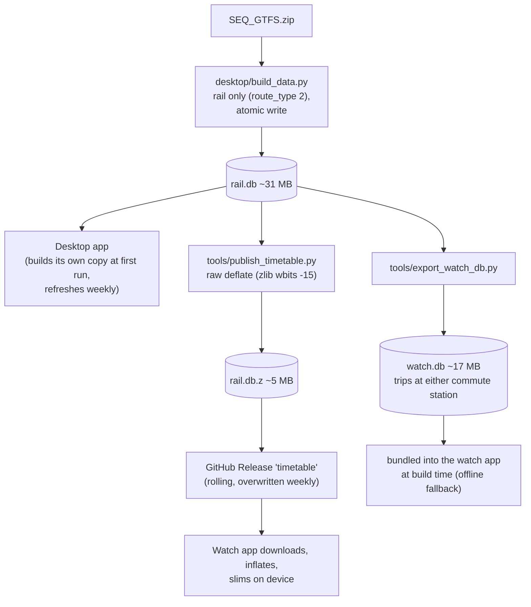
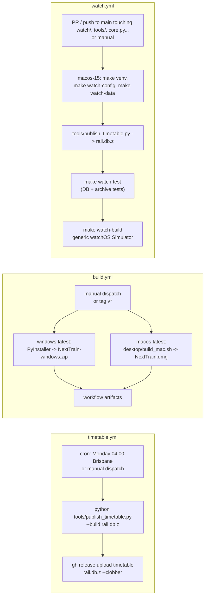
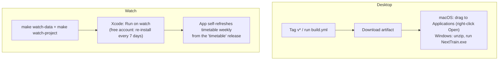

# Data pipeline, CI/CD and releases

## Data sources

| Source | URL | Used for |
|---|---|---|
| Static GTFS (zip) | `https://gtfsrt.api.translink.com.au/GTFS/SEQ_GTFS.zip` | timetable (trips, stop times, calendars) |
| GTFS-Realtime TripUpdates (protobuf) | `https://gtfsrt.api.translink.com.au/api/realtime/SEQ/TripUpdates` | live delays and cancellations |

Both are free, with no API key. The realtime feed sends **no CORS headers**, so a browser-only app could not use it;
native apps (desktop, watch) are unaffected. Realtime only carries trips about to run; far-future trains show
scheduled times. Data is TransLink open data: follow their licence/attribution terms.

## Timetable pipeline

| Tool | Purpose |
|---|---|
| `desktop/build_data.py` | GTFS zip → `rail.db`. Also used by the desktop app itself. |
| `tools/publish_timetable.py [--build] [out.z]` | Compress `rail.db` into the published asset. `--build` downloads and builds first (CI does this). |
| `tools/export_watch_db.py [out.db]` | Build the slim bundled `watch.db` for the *configured* stations (reads `desktop/config.json`). |

**Why the published file is the whole network** and not a per-user slim DB: the repository is public and the
slimming happens on the watch, so no one's commute stations leave their device. The format is **raw deflate** because
Apple's `Compression` framework (`InputFilter(.decompress, using: .zlib)`) reads raw deflate natively.

### GTFS quirks

- Times can exceed `24:00:00` (after-midnight trips belong to the previous service day), so queries always check
  yesterday, today and tomorrow.
- Weekend trackwork railbus replacements appear as **rail-route trips ending at the interchange station** (e.g.
  Shorncliffe↔Northgate). There may be no direct trip for an origin→destination pair for days; this is the reason
  for one-change journeys.
- A service pattern can start on a future date (regular Saturday service resuming), so "nothing published" is
  usually the feed, not a bug. Check `calendar` / `calendar_dates` first.
- The `st` table only stores `dep`; it is used as the arrival time proxy at intermediate stops.

## CI workflows (`.github/workflows/`)

| Workflow | Trigger | Output |
|---|---|---|
| `timetable.yml` | weekly cron, manual | Release `timetable` asset `rail.db.z` (created on first run if missing) |
| `build.yml` | manual, tags `v*` | Artifacts `NextTrain-windows` (zip) and `NextTrain-mac` (dmg) |
| `watch.yml` | PRs and pushes to `main` that touch `watch/`, `tools/` or the shared Python, plus manual | Pass/fail: Swift tests + simulator build (~3 min, no artifacts) |

`watch.yml` uses the generic example stations (Central / Roma Street) and a freshly built timetable, so it needs no
secrets and no signing. It does **not** install on a device: that stays a local Xcode step because it needs your
Apple ID. Tests that depend on the date use "the next weekday 07:30", so they keep working as the feed rolls over.

## Deployment summary

Nothing is hosted: no servers, databases or secrets. The only credential used anywhere is the automatic
`GITHUB_TOKEN` in `timetable.yml` (`contents: write`).
