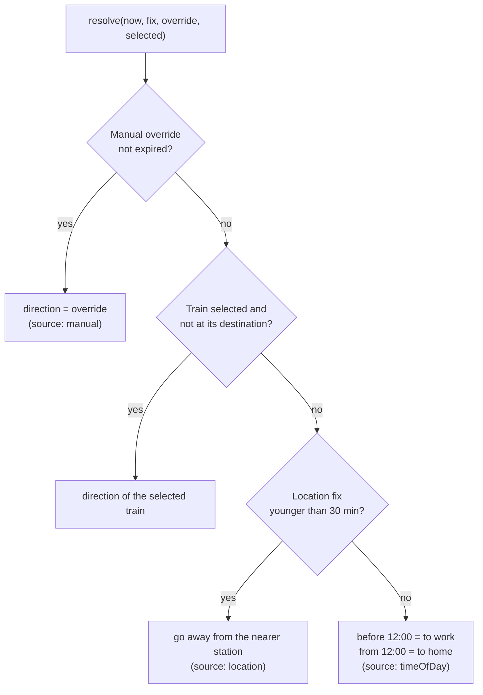
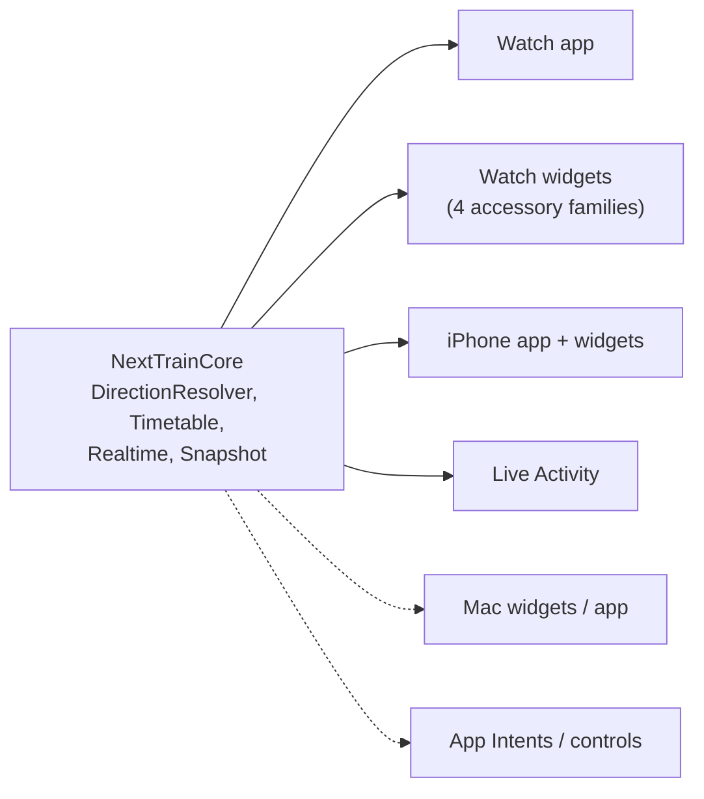

# Surfaces and direction rule

Every place NextTrain can appear (a *surface*), when it is visible, and what it shows. Status: ✅ built, 🟡 planned.
This file is the living reference for the canvas map.

## One direction rule for every surface

"Which way am I going, to work or to home?" is decided by `DirectionResolver`
(`watch/NextTrainCore/Sources/NextTrainCore/DirectionResolver.swift`), the single source of truth used by the app,
complications and intents. The desktop `core.snapshot` follows the same fallback so the two ports agree.

| Rule detail | Value |
|---|---|
| Fix freshness | 30 minutes (`DirectionResolver.fixMaxAge`) |
| Manual override lifetime | until the next 04:00 Brisbane time or 3 hours, whichever is first |
| Time-of-day split | 12:00, every day of the week (matches the 06:30 / 16:30 commute alerts) |
| Boarding station | with a trusted location: the candidates nearest to you; otherwise the station on the other side of the journey |

`Timetable.resolvedSnapshot(config:store:location:selected:now:rt:)` is what surfaces call: it records the fix, resolves
the direction, and builds the snapshot. `DirectionStore` persists the last fix and override in `UserDefaults`.

**Free Apple ID limitation:** app and widget are separate processes without App Groups, so each keeps its **own**
fix and override. They agree whenever both have a fresh location, or both fall back to time of day. A manual switch
made in the app does not reach the complication until App Groups are available (paid account); see
[watch-app.md](watch-app.md#direction-app-vs-complication). The widget gets a location only if watchOS lets the
extension read it (`NSWidgetWantsLocation`); this must be verified on a real device.

## Surface map

| Surface | Platform | Visible when | Interaction | Shows | Status |
|---|---|---|---|---|---|
| Watch app | watchOS 10+ | user opens it | scroll, tap trip, pull to refresh, **Switch to work/home** | up to 4 departures, delays, changes, why this direction | ✅ |
| `accessoryRectangular` | watch face, Smart Stack | always on the face | tap opens app; in Smart Stack the route line switches direction | route + next 3 trains | ✅ |
| `accessoryInline` | watch face | always | tap | `07:42 +2m <headsign>` | ✅ |
| `accessoryCorner` | watch face | always | tap | time + headsign label | ✅ |
| `accessoryCircular` | watch face | always | tap | next departure time + "in Nm" | ✅ |
| Smart Stack relevance (commute times) | watchOS | promoted near 06:30 / 16:30 | tap | rectangular view | 🟡 |
| iPhone app (`NextTrainiOS`) | iOS 17+ | user opens it | list of 8, trip detail, direction switch, pull to refresh | same engine | ✅ simulator |
| Home Screen widgets small/medium (`NextTrainiOSWidget`) | iOS 17+ | on a page | tap opens app | next train(s) | ✅ builds; large + StandBy 🟡 |
| Lock Screen widgets | iOS 17+ | lock screen | tap | circular / rectangular / inline | ✅ builds |
| Live Activity, Dynamic Island (`TrainLiveActivity`) | iOS 16.2+, watch mirror | after long-press > "Track this train" in the iPhone app | tap | countdown, delay, platform, arrival | ✅ builds, untested on device |
| Control Centre control (`NextTrainControl`) | iOS 18 | on demand, also Lock Screen / Action button slot | tap runs `ToggleDirectionIntent` | switch direction | ✅ builds |
| Siri / Shortcuts / Action button | iOS 17+, watchOS 10+ | on demand | `NextTrainIntent` ("Next train in NextTrain"), `ToggleDirectionIntent` | spoken next train / switch | ✅ builds, untested on device |
| Mac widgets (`NextTrainMacWidget`) | macOS 14+ | desktop, Notification Centre | tap | small / medium next trains | ✅ builds |
| Mac app (`NextTrainMac`, `MenuBarExtra`) | macOS 14+ | always in the menu bar | popover list, switch direction, refresh | next time in the menu bar; 6 departures | ✅ runs; Python app still the full one |

Solid arrows exist; dotted ones are planned. Build each view once per information level (glance = one train,
list = 3-4 trains, detail = stops) and map it to families, rather than one design per surface.

## Smart Stack relevance

Each widget timeline entry carries a `TimelineEntryRelevance`: score 100 on weekdays 06:00-09:00 and 16:00-18:30 (Brisbane time), 10 otherwise, so watchOS promotes the widget in the Smart Stack around commute time. Taps open the app through a `nexttrain://home`, `work` or `auto` URL (the app does not yet act on the direction in the URL).

## App Intents and controls

`Shared/NextTrainIntents.swift` holds `NextTrainIntent` (answers with the next train, live if online) and `ToggleDirectionIntent`. `Shared/NextTrainShortcuts.swift` registers them as App Shortcuts and is compiled only into the apps, not the widget extensions. To use the Action button on an Apple Watch Ultra or iPhone, open Settings > Action Button and pick the "Next train" shortcut. Free-account limitation: the intents run in whichever process invokes them, so a direction switch made from a control does not reach the app until App Groups exist (see Direction rule above).

## Live Activity

`Shared/TrainActivity.swift` defines `TrainActivityAttributes` and `TrainTracker` (iOS only). Long-press a departure in the iPhone app and choose "Track this train"; the app updates the activity each time it refreshes and ends it after the train leaves. Updates are local, so they only arrive while the app runs (push updates need a paid account and a server). Live Activities mirror to a paired Apple Watch's Smart Stack automatically on watchOS 11+.

## Native Mac app: parity with the Python app

The Swift Mac app (`watch/NextTrainMac`) shows the next time in the menu bar and a popover with six departures, a direction switch and refresh. It is not yet a replacement for `desktop/`. Selected-train highlight and alerts now work like the Python app (see below). Missing: launch at login, the Python-style scrolling list, a settings window for stations (they come from `LocalConfig.swift`), and Developer ID signing/notarisation (needs a paid account). Retire the Python app only when these exist.

## Upgrading to App Groups (paid account)

All direction state goes through `AppConfig.directionStore` (`watch/Shared/AppConfig.swift`). On a free account it is per-process `UserDefaults`. With a paid Apple Developer account:

1. In Xcode, for every target (watch app + widget, iPhone app + widget, Mac app + widget) add the **App Groups** capability with one group id, e.g. `group.com.yourname.nexttrain`.
2. Set `AppConfig.appGroup` to that id.
3. Rebuild. The app, complications, widgets, controls and intents now share the manual override and last location fix, so a switch made anywhere shows up everywhere.

Not done yet (still per-process even with the group): sharing the downloaded timetable DB through the group container, and Live Activity push updates.

## Selected train and alerts

Ported from the Python app (`desktop/engine.py`, `desktop/menubar.py`):

| Behaviour | Python | Swift (`Tracking.swift`, `Shared/AlertScheduler.swift`) |
|---|---|---|
| Pick a train | click a row | iPhone: swipe a row or long-press; watch: swipe a row or open it and tap "Remind me"; Mac: click the row |
| Highlight | bright green bold row with a tick, `✓` in the title | `DepartureRow(selected:)` and `Format.trackedTitle` (`✓ 07:42 (5m) → 08:10 (33m)`, then `arr 08:10 (3m)`) |
| Direction | the selected train decides the direction | passed to `DirectionResolver` as `selected` (rule 2) |
| Trip detail colours | boarding stop blue, current stop green, passed stops grey | `TripStopsList` |
| Reminders | "Train in N min" every minute from 15 to 10 min before, plus "Arriving" 2 min before the destination, with the train sound | `AlertPlanner.tracked`, scheduled as local notifications |
| Commute reminders | next train every 10 min for 45 min from 06:30 (work) and 16:30 (home), Mon-Fri | `AlertPlanner.commute` (config: `AlertConfig`) |
| Pause / resume | menu item | "Pause alerts" button (`TrackStore.alertsActive`) |
| Selection ends | when the train has arrived | `TrackStore.update` drops it a minute after arrival |

Difference: the Python app runs all day and checks every minute. Apple apps cannot, so alerts are **scheduled ahead as local notifications** (from the offline timetable) and rescheduled on every refresh, which moves them when the train is delayed. Live delays therefore only take effect when the app has refreshed, so open it once after picking a train. iOS allows 64 pending notifications; the soonest 60 are kept. The train sound (`Shared/train.wav`, generated by `desktop/sound.py`) plays on iPhone and Mac; watchOS does not allow custom notification sounds, so it uses the default tone and haptic.

Selection is stored per process (`TrackStore`), so on a free account a train picked on the watch is not highlighted on the iPhone or in widgets until App Groups exist (`AppConfig.appGroup`).
