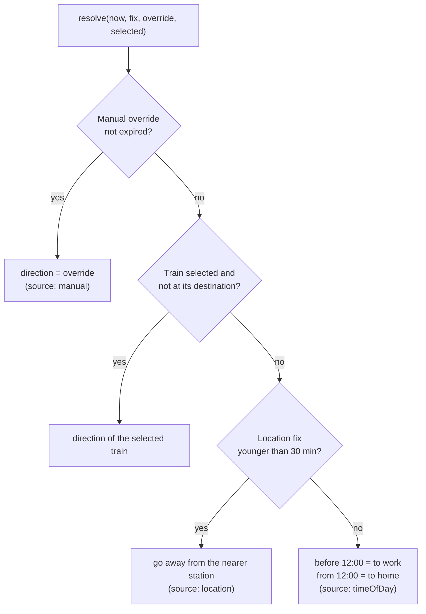
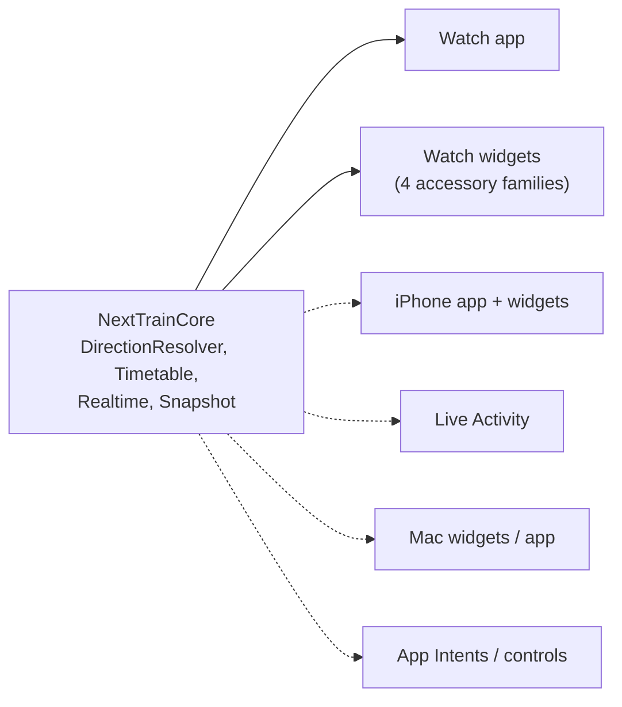

# Surfaces and direction rule

Every place NextTrain can appear (a *surface*), when it is visible, and what it shows. Status: ✅ built, 🟡 planned.
This file is the living reference for the canvas map.

## One direction rule for every surface

"Which way am I going, to work or to home?" is decided by `DirectionResolver`
(`watch/NextTrainCore/Sources/NextTrainCore/DirectionResolver.swift`), the single source of truth used by the app,
complications and intents. The desktop `core.snapshot` follows the same fallback so the two ports agree.

| Rule detail | Value |
|---|---|
| Fix freshness | 30 minutes (`DirectionResolver.fixMaxAge`) |
| Manual override lifetime | until the next 04:00 Brisbane time or 3 hours, whichever is first |
| Time-of-day split | 12:00, every day of the week (matches the 06:30 / 16:30 commute alerts) |
| Boarding station | with a trusted location: the candidates nearest to you; otherwise the station on the other side of the journey |

`Timetable.resolvedSnapshot(config:store:location:selected:now:rt:)` is what surfaces call: it records the fix, resolves
the direction, and builds the snapshot. `DirectionStore` persists the last fix and override in `UserDefaults`.

**Free Apple ID limitation:** app and widget are separate processes without App Groups, so each keeps its **own**
fix and override. They agree whenever both have a fresh location, or both fall back to time of day. A manual switch
made in the app does not reach the complication until App Groups are available (paid account); see
[watch-app.md](watch-app.md#direction-app-vs-complication). The widget gets a location only if watchOS lets the
extension read it (`NSWidgetWantsLocation`); this must be verified on a real device.

## Surface map

| Surface | Platform | Visible when | Interaction | Shows | Status |
|---|---|---|---|---|---|
| Watch app | watchOS 10+ | user opens it | scroll, tap trip, pull to refresh, **Switch to work/home** | up to 4 departures, delays, changes, why this direction | ✅ |
| `accessoryRectangular` | watch face, Smart Stack | always on the face | tap opens app; in Smart Stack the route line switches direction | route + next 3 trains | ✅ |
| `accessoryInline` | watch face | always | tap | `07:42 +2m <headsign>` | ✅ |
| `accessoryCorner` | watch face | always | tap | time + headsign label | ✅ |
| `accessoryCircular` | watch face | always | tap | next departure time + "in Nm" | ✅ |
| Smart Stack relevance (commute times) | watchOS | promoted near 06:30 / 16:30 | tap | rectangular view | 🟡 |
| iPhone app | iOS 17+ | user opens it | full list, detail, direction switch | same engine | 🟡 |
| Home Screen widgets (S/M/L), StandBy | iOS 17+ | on a page / when docked | `Button(intent:)` | next train(s) | 🟡 |
| Lock Screen widgets | iOS 17+ | lock screen | tap | circular / rectangular / inline | 🟡 |
| Live Activity, Dynamic Island | iOS 16.2+, watch mirror | while tracking one train | tap | countdown, delay, platform | 🟡 |
| Control Centre control, Action button | iOS 18, Watch Ultra | on demand | App Intent | switch direction / next train | 🟡 |
| Mac widgets | macOS 14+ | desktop, Notification Centre | `Button(intent:)` | next trains | 🟡 |
| Mac app | macOS 13+ (`MenuBarExtra`) | always in the menu bar | full | parity with the Python app, then replaces it | 🟡 |

Solid arrows exist; dotted ones are planned. Build each view once per information level (glance = one train,
list = 3-4 trains, detail = stops) and map it to families, rather than one design per surface.

## Smart Stack relevance

Each widget timeline entry carries a `TimelineEntryRelevance`: score 100 on weekdays 06:00-09:00 and 16:00-18:30 (Brisbane time), 10 otherwise, so watchOS promotes the widget in the Smart Stack around commute time. Taps open the app through a `nexttrain://home`, `work` or `auto` URL (the app does not yet act on the direction in the URL).
