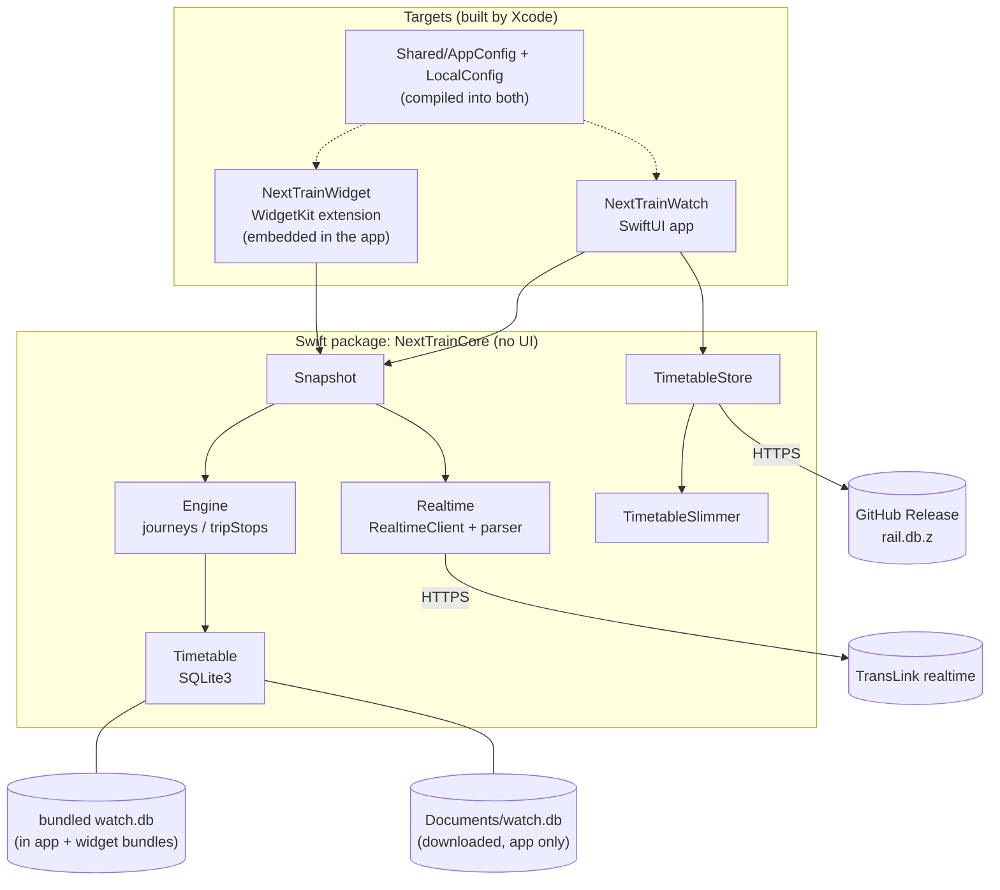
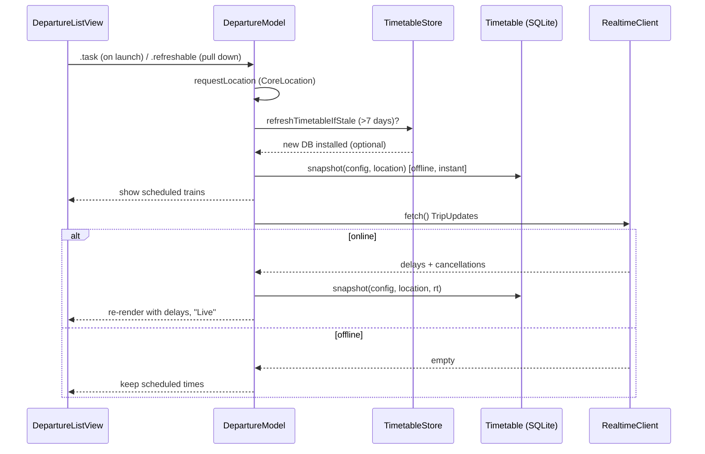
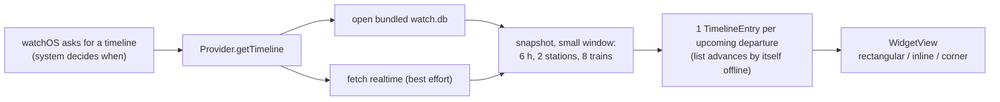
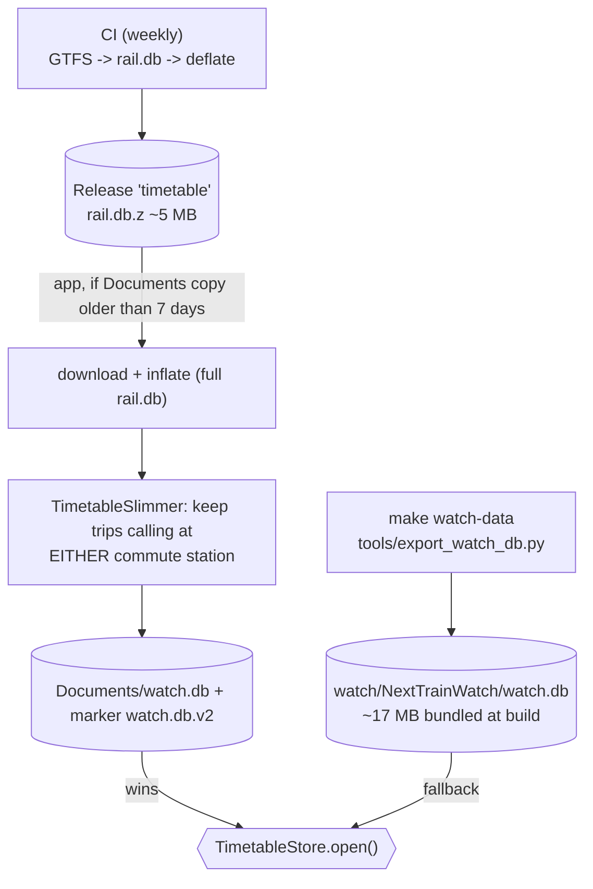
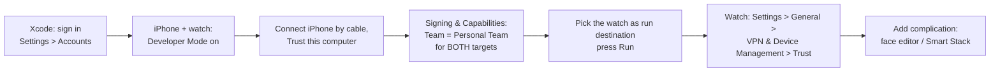

# Apple Watch app

Folder: [`watch/`](../watch). A **standalone watchOS app** (no iPhone app required) plus a **complication**
(Smart Stack / watch-face widget). Offline it shows scheduled trains from a bundled timetable; online it overlays live
delays from TransLink. Written in Swift/SwiftUI; the logic is a port of the Python core
([architecture.md](architecture.md#the-python--swift-port)).

## Apple-platform primer (for developers new to iOS/watchOS)

| Term | What it means here |
|---|---|
| **Xcode** | Apple's IDE and build system. Required for any watch build; macOS only. |
| **Swift / SwiftUI** | The language / the declarative UI framework (views are structs describing the screen). |
| **Target** | One buildable product. We have two: the watch **app** and the **widget extension** (complication). |
| **Scheme** | Which target(s) Xcode builds and runs. Use `NextTrainWatch`. |
| **Swift package (SwiftPM)** | A library with its own `Package.swift`. `NextTrainCore` is ours, with no UI, so it is testable with plain `swift test`. |
| **XcodeGen / `project.yml`** | The `.xcodeproj` is *generated* from [`watch/project.yml`](../watch/project.yml) and is git-ignored. Edit the YAML, never the project file. |
| **Bundle ID** | Unique app identifier (`com.simonclur.nexttrain.watch`; widget adds `.widget`). Change it if signing says it's taken. |
| **Signing / Team** | Apps must be signed to run on a device. A free Apple ID gives a *Personal Team*; no paid account needed for your own devices. |
| **Simulator** | A virtual watch on the Mac. No signing needed (`CODE_SIGNING_ALLOWED=NO`). |
| **WidgetKit** | Framework for complications. The system, not our app, decides *when* a widget runs, from a **timeline** of pre-computed entries. |
| **Info.plist** | App metadata (permissions text, "watch-only"). Ours are in `NextTrainWatch/` and `NextTrainWidget/`. |

## Repository layout

```
watch/
├── project.yml                  XcodeGen definition (targets, bundle IDs, deployment target, signing team)
├── LocalConfig.example.swift    template for your stations -> copy to Shared/LocalConfig.swift (git-ignored)
├── Shared/
│   ├── AppConfig.swift          config + timetable URL + refresh rule; compiled into BOTH targets
│   └── LocalConfig.swift        YOUR stations (git-ignored, required to build)
├── NextTrainCore/               Swift package: all logic, no UI
│   ├── Package.swift
│   ├── Sources/NextTrainCore/
│   │   ├── Models.swift         Station, Departure, Leg2, Brisbane time zone, haversine
│   │   ├── Timetable.swift      SQLite3 reader (stations, calendar, queries)
│   │   ├── Engine.swift         nextTrains, journeys/transferJourneys, tripStops
│   │   ├── Realtime.swift       protobuf parser, delay rules, RealtimeClient (20 s cache)
│   │   ├── DirectionResolver.swift  shared to-work/to-home rule, LastFix, DirectionStore
│   │   ├── Snapshot.swift       snapshot() + resolvedSnapshot(): both directions, nearest station, primary leg
│   │   ├── TimetableStore.swift locate / download / swap the timetable DB
│   │   ├── TimetableSlimmer.swift inflate rail.db.z + keep only trips at your stations
│   │   └── TimelineBuilder.swift  Snapshot -> DisplayEntry per upcoming departure (shared by every widget)
│   ├── Sources/NextTrainUI/     shared SwiftUI views per information level (glance / list / detail)
│   │   └── Views.swift          DepartureRow, TripStopsList, CompactTrainsView, Inline/Circular/CornerGlance
│   └── Tests/NextTrainCoreTests/
├── NextTrainWatch/              the app target (SwiftUI)
│   ├── NextTrainWatchApp.swift  @main entry
│   ├── DepartureListView.swift  list + TripDetailView
│   ├── Info.plist
│   └── watch.db                 bundled timetable (generated, git-ignored)
├── Shared/                      compiled into every app/widget target: AppConfig, LocalConfig, Model.swift (DepartureModel)
├── NextTrainiOS/                iPhone app (ContentView) + Info plists; its widget target reuses NextTrainWidget/ sources
└── NextTrainWidget/             the complication / widget target (WidgetKit; also built for iOS as NextTrainiOSWidget)
    ├── NextTrainWidget.swift    Provider (timeline) + views
    └── Info.plist
```

## Architecture



Key design points:

- **No third-party dependencies.** SQLite3 is a system library, protobuf is parsed by hand (`Realtime.swift`), inflate
  uses Apple's `Compression` framework.
- **The package knows nothing about UI or the app's config**; callers pass a `CommuteConfig`. That keeps it testable.
- **App and widget do not share files** (App Groups need a paid account). Each reads its own bundled `watch.db`; only
  the app downloads a fresher one.

## How the app runs



Rendering is two-phase on purpose: the first paint never waits on the network. Data is refetched on launch and on pull-down only; a 30 s `TimelineView` just redraws the relative times ("in 12m").

### One-change journeys

`Timetable.journeys` returns direct trains; if none are upcoming it adds `transferJourneys` (min change 3 minutes).
The row text reads *"change at Northgate → Shorncliffe"*. `Departure.leg2` carries the second leg for live arrival;
selection identity is the first leg's `tripId`.

## Direction: app vs complication

Both use `Timetable.resolvedSnapshot`, i.e. the shared rule in [surfaces.md](surfaces.md#one-direction-rule-for-every-surface)
(manual override > selected train > fresh location > time of day). The app shows *Switch to work/home* and *Back to
automatic*, plus a footer saying why ("set by you", "by location", "by time of day"). The complication switches
direction by tapping its route line in the Smart Stack (on a watch face a tap opens the app instead).

Without App Groups (free account) the app and the widget keep **separate** fix and override state, so a manual switch
in the app does not change the complication; it returns to the automatic answer. This is the one known disagreement.
It goes away by sharing a `UserDefaults(suiteName:)` once a paid account allows App Groups
(`DirectionStore(defaults:)` already accepts a suite).

## The complication



- Supported families: `accessoryRectangular`, `accessoryInline`, `accessoryCorner`, `accessoryCircular`.
- **The widget must stay cheap.** Extensions have tight memory/time limits. It does not download the timetable and
  queries a small window. When it cannot produce data it shows the reason ("No timetable DB", "Err: …").
- Reloads are *requested* every ≤ 15 min, but watchOS may delay them. After adding the complication it can take a few
  seconds to populate.
- Station set for the widget comes from `LocalConfig`. Direction uses the last known location if watchOS grants it to the extension (`NSWidgetWantsLocation`), else time of day.

## Timetable lifecycle



- `TimetableStore.open()` prefers the downloaded copy, else the bundled one.
- `formatVersion` in `TimetableStore.swift` is bumped whenever the slim DB's *contents* change. A downloaded copy
  without the matching marker file is deleted on launch. **Bump it if you change `TimetableSlimmer`** or old copies
  on devices will shadow the new bundled DB.
- Trips calling at *either* station are kept (not both) so that one-change journeys can be found.

## Setup

Prerequisites: macOS, **Xcode** (App Store; includes watchOS simulator), **XcodeGen** (`brew install xcodegen`), and the
repo's Python venv (`make venv`) to build the timetable.

```bash
make venv                       # once
make watch-config               # creates watch/Shared/LocalConfig.swift; edit your home/work stations in it
make watch-data                 # builds the timetable and bundles it into the app (needs network)
make watch-project              # generates watch/NextTrain.xcodeproj
open watch/NextTrain.xcodeproj  # then pick the NextTrainWatch scheme
```

`LocalConfig.swift` and `watch.db` are generated per developer and **never committed** (stations are personal).

## Run in the simulator

In Xcode choose the `NextTrainWatch` scheme and a watch simulator (e.g. *Apple Watch Series 12 (46mm)*), press ⌘R.
Or from the terminal: `make watch-build` (compile check only). The simulator has no real GPS: the app uses
`fallback` coordinates unless you set *Features → Location* in the simulator.

## Deploy to a real watch (free Apple ID)



1. Xcode → Settings → Accounts → add your Apple ID.
2. On the iPhone and the watch: Settings → Privacy & Security → **Developer Mode** → on (restarts the device).
3. In `project.yml` set `DEVELOPMENT_TEAM` to your Team ID (or set the Team in *Signing & Capabilities* for both
   targets), then `make watch-project`. If the bundle ID is rejected, change `bundleIdPrefix`/the IDs in `project.yml`.
4. Select the watch as the run destination and press ⌘R.
5. On the watch trust the developer profile if prompted.

Free-account limits: the install **expires after 7 days** (reinstall from Xcode; that also refreshes the bundled
timetable used by the complication), a maximum of 3 apps, no App Groups, push or TestFlight. A paid Developer Program
membership lifts these and is required for TestFlight/App Store distribution.

### Adding the complication

Press and hold the watch face → **Edit** → **Complications** → tap a slot → choose **NextTrain**. The face must have a
rectangular slot (e.g. *Modular*, *Modular Duo*, *Modular Ultra*), or add it to the **Smart Stack** (Digital Crown → Edit).

## Tests

```bash
make watch-test                                              # unit tests that need no data (protobuf parser)
cd watch/NextTrainCore && \
  NEXTTRAIN_DB=/path/watch.db NEXTTRAIN_HOME="Central" NEXTTRAIN_WORK="Roma Street" \
  swift test --scratch-path /tmp/ntbuild                     # DB-backed tests
```

| Env var | Enables |
|---|---|
| `NEXTTRAIN_DB` (+ `HOME`, `WORK`) | timetable, snapshot, trip-stop and transfer-consistency tests |
| `NEXTTRAIN_ARCHIVE` | inflate + slim test of a real `rail.db.z` (`make timetable` creates one) |
| `NEXTTRAIN_CHANGE_PARITY` | a date-specific check of the Oct 2026 trackwork journeys (needs the matching timetable snapshot) |

Tests without their env vars are skipped, not failed. **Always pass `--scratch-path` outside the project folder** when
the repo lives in Dropbox/iCloud: file-sync extended attributes break code signing of the test bundle.

### Continuous integration

`.github/workflows/watch.yml` runs the above on a macOS runner for every PR/push touching the watch or its data tools:
it builds a generic timetable, runs `make watch-test` with the DB and archive env vars set, then
`make watch-build DEST='generic/platform=watchOS Simulator'`. Reproduce locally with the same commands (use your own
`HOME_STN`/`WORK_STN` if your local `watch.db` was built for your own stations). See [pipeline-and-ci.md](pipeline-and-ci.md#ci-workflows-githubworkflows).

## Troubleshooting

| Symptom | Cause / fix |
|---|---|
| Build error: cannot find `LocalConfig` | `make watch-config` |
| "watch.db missing" in the app | `make watch-data` then rebuild |
| App is "Live" but shows no trains on the device | A stale downloaded DB from an older format shadows the bundle; fixed by the version marker. Reinstall; check `formatVersion`. |
| Complication blank/placeholder | Remove and re-add it; give it a few seconds. Text such as "No timetable DB" tells you why. |
| Complication not in the list | Open the app once, reinstall, restart the watch; check the extension is embedded in the app. |
| Weekend shows nothing | Trackwork: only changes are available. See the GTFS notes in [pipeline-and-ci.md](pipeline-and-ci.md#gtfs-quirks). |
| `swift test` fails at codesign | Use `--scratch-path /tmp/ntbuild` (see Tests). |
| App stops working after a week | Free-account signing expired; rerun from Xcode. |
